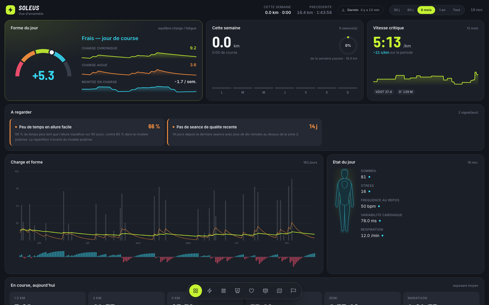
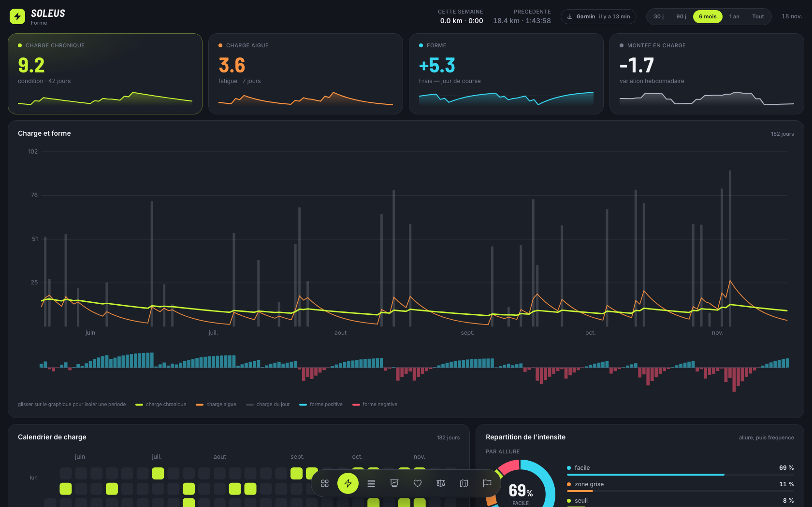
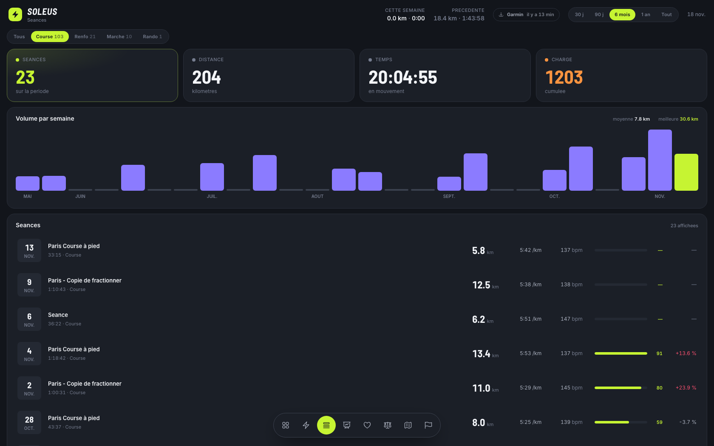
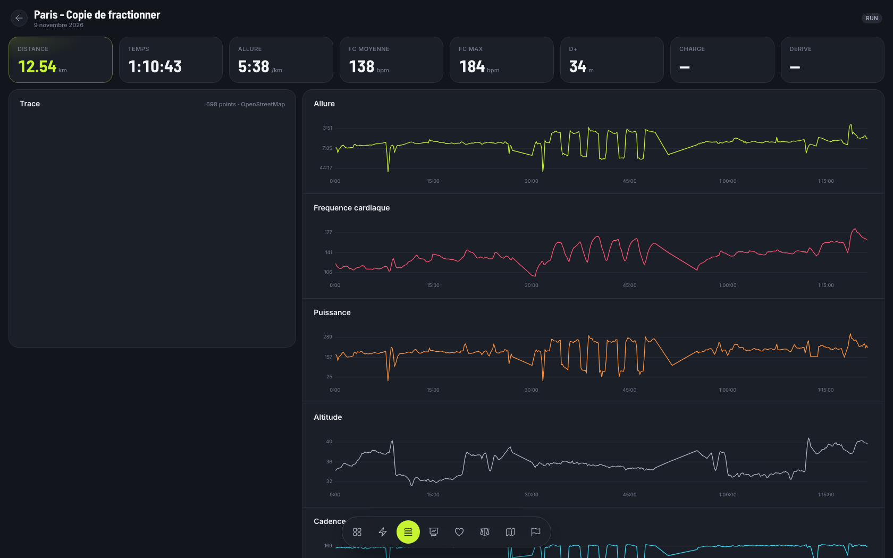
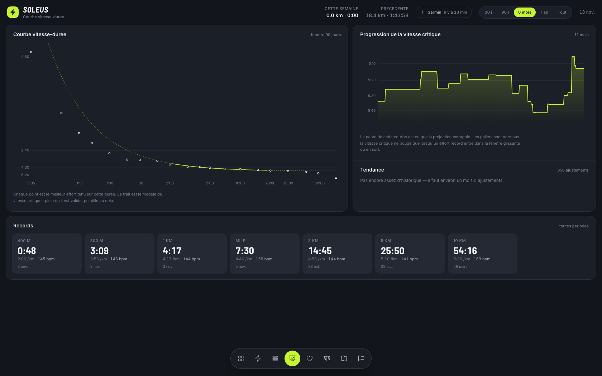
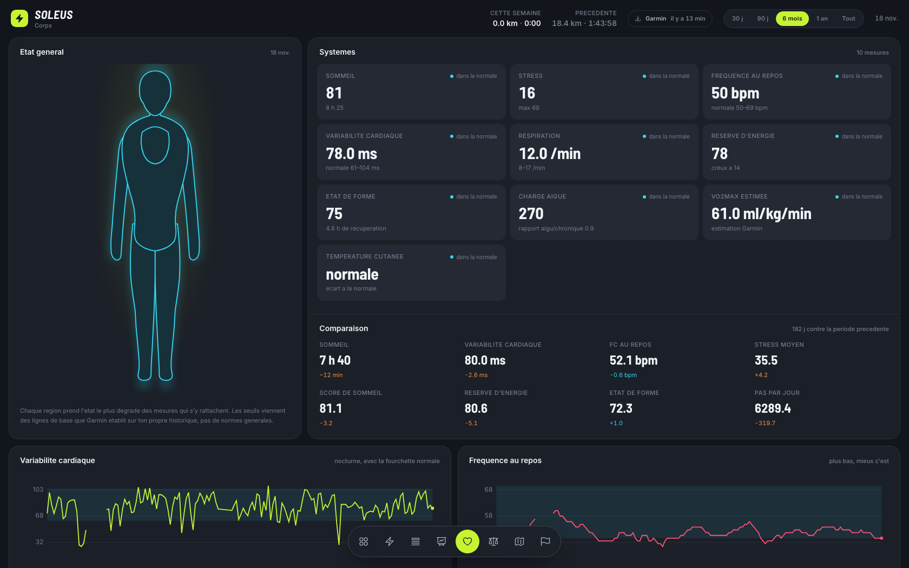
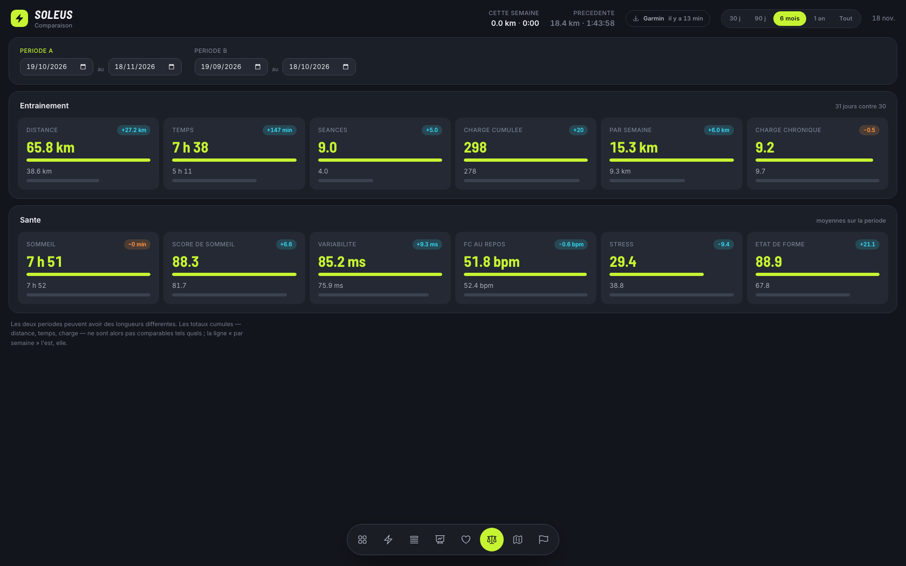
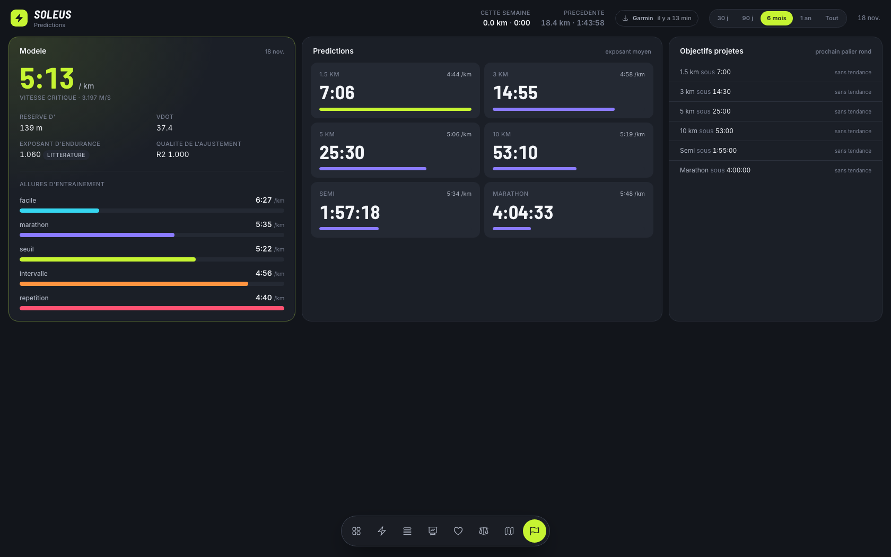
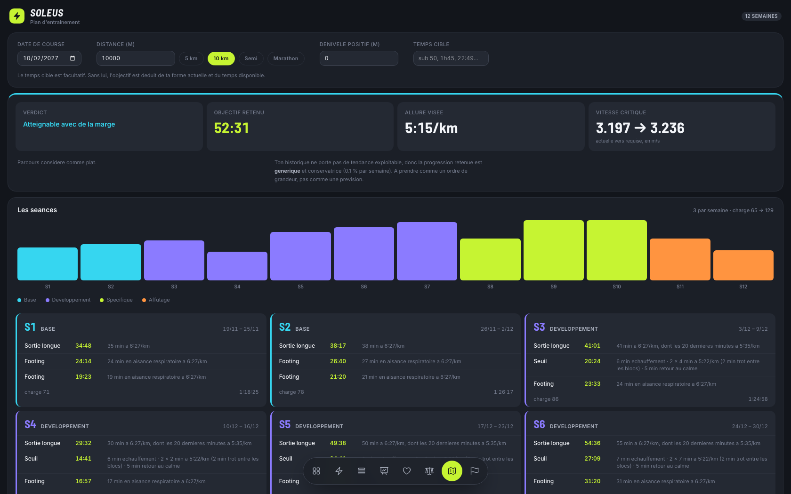

# Soleus

Tableau de bord d'entrainement en course a pied : suivi des seances, modeles
physiologiques, et projection de progression. Les donnees viennent d'une
montre Garmin.



## Apercu

| | |
| --- | --- |
|  **Forme** — charge et forme, calendrier, intensite |  **Seances** — volume hebdomadaire et liste |
|  **Seance** — trace, series, tours |  **Courbe** — vitesse-duree et records |
|  **Corps** — sante et lignes de base |  **Comparer** — deux periodes cote a cote |
|  **Predictions** — modele et temps de course |  **Plan** — trame vers une course datee |

## Ce que fait Soleus

- **Ingestion** des fichiers `.fit` Garmin, idempotente (l'empreinte du
  fichier est la cle : reimporter un export ne cree pas de doublon).
- **Metriques par seance** : charge d'entrainement, TRIMP, facteur
  d'intensite, decouplage aerobie.
- **Courbe vitesse-duree** : meilleur effort sur chaque palier de duree et sur
  chaque distance de course.
- **Modeles** : vitesse critique et reserve anaerobie, exposant d'endurance,
  VDOT, allures d'entrainement derivees.
- **Charge et forme** : modele de Banister (charge chronique, charge aigue,
  forme du jour), taux de montee en charge.
- **Projection** : date a laquelle un objectif devient atteignable, par
  extrapolation de la vitesse critique.

## Mise en route

```sh
docker compose up -d db     # Postgres 17 sur le port 5436
mix deps.get
mix ecto.setup
mix phx.server              # http://localhost:4006
```

Les ports sont volontairement non standards (`5436` pour Postgres, `4006` pour
le serveur) : plusieurs projets coexistent sur la machine de developpement.

### Historique de demonstration

Pour avoir un tableau de bord vivant sans attendre un export Garmin :

```sh
mix run priv/repo/seeds_demo.exs
mix soleus.rebuild
```

Le generateur construit six mois de seances a partir d'une vitesse critique
qui progresse lentement. C'est aussi un test du moteur : si la vitesse
critique ajustee a la fin ne retrouve pas celle injectee au depart, le moteur
a tort.

## Recuperer ses donnees Garmin

Trois chemins, complementaires :

| Source | Contenu | Limites |
| --- | --- | --- |
| **Export RGPD** Garmin Connect | tout l'historique en `.fit` | manuel, a faire une fois |
| **Personal API** Garmin | activites, `.fit`, sommeil, HRV, Body Battery | cle expirable, token 24 h sans rafraichissement, backfill ~30 jours, pas de webhook |
| **API Strava** | flux 1 Hz, webhook, historique complet | donnees retravaillees, ni HRV ni Body Battery ni Running Dynamics |

La combinaison retenue est l'export RGPD pour amorcer l'historique, puis la
Personal API pour l'incremental quotidien.

### Charger son historique dans le tableau de bord

C'est l'etape a faire une fois, a l'installation. Sans elle le tableau de bord
est vide (ou montre l'historique de demonstration).

**1. Demander l'export a Garmin.** Sur Garmin Connect : *Compte* → *Gestion
des donnees* → *Exporter vos donnees*
(<https://www.garmin.com/account/datamanagement/exportdata/>). Garmin prepare
l'archive puis envoie un lien de telechargement par email ; compter de
quelques heures a quelques jours.

**2. Decompresser l'archive**, par exemple dans `~/Documents/data_garmin`. La
seule partie utile est le dossier `DI_CONNECT` :

```text
data_garmin/DI_CONNECT/
├── DI-Connect-Uploaded-Files/UploadedFiles_*.zip   les fichiers .fit des seances
├── DI-Connect-Fitness/*_summarizedActivities.json  noms, zones et details des seances
└── DI-Connect-Wellness/                           sommeil, HRV, stress, lignes de base
```

**3. Lancer les imports, dans cet ordre** (base demarree, application
arretee : chaque tache demarre l'application et prend le port 4006) :

```sh
EXPORT=~/Documents/data_garmin/DI_CONNECT

# les fichiers .fit des seances, decompresses ou l'import les attend
unzip -o -d priv/import/fit "$EXPORT"/DI-Connect-Uploaded-Files/UploadedFiles_*.zip

mix soleus.import                                                      # seances
mix soleus.enrich "$EXPORT"/DI-Connect-Fitness/*_summarizedActivities.json   # noms, zones, details
mix soleus.wellness "$EXPORT"                                          # sante quotidienne
mix soleus.rebuild                                                     # metriques, charge, modeles
```

| Tache | Ce qu'elle fait |
| --- | --- |
| `soleus.import` | lit chaque `.fit` de `priv/import/fit` (sous-dossiers compris) et cree les seances, leurs series, tours et efforts records |
| `soleus.enrich` | complete les seances avec le resume de Garmin : nom, zones de frequence, champs absents du `.fit` |
| `soleus.wellness` | importe le sommeil, la HRV, la frequence au repos, le stress, la reserve d'energie et les lignes de base personnelles |
| `soleus.rebuild` | recalcule tout ce qui se deduit des seances : charge, forme, vitesse critique, predictions |

`soleus.rebuild` n'est pas facultatif : les imports ne calculent aucune
metrique, et sans lui les pages Forme, Courbe et Predictions restent vides.

**4. Verifier**, puis lancer le serveur :

```sh
mix run -e 'IO.inspect(Soleus.Repo.aggregate(Soleus.Training.Activity, :count), label: "seances")'
mix phx.server   # http://localhost:4006
```

Tout est **reexecutable sans risque** : l'empreinte de chaque fichier sert de
cle, et la sante s'ecrit par date. Pour ajouter un export plus recent,
recommencer les etapes 2 et 3 ; seules les nouveautes sont ajoutees.

Un export contient surtout des fichiers qui ne sont pas des seances : sur
8 675 fichiers, 134 sont des activites, le reste etant du suivi quotidien et
de la HRV nocturne. L'import les ecarte tout seul. Le dossier `priv/import/`
est ignore par git : les donnees ne quittent pas la machine.

`mix soleus.laps` ne sert qu'a une base importee avec une ancienne version de
Soleus : il relit les tours et les dynamiques de course sans tout reimporter.

Ensuite, pour ne plus avoir a refaire d'export, brancher la Personal API
ci-dessous : elle prend le relais pour les nouvelles seances.

### Brancher la Personal API

```sh
# 1. creer une cle sur https://connect.garmin.com/app/settings/personalApiToken
#    (elle n'est affichee qu'une seule fois)
# 2. la poser dans .env
echo 'GARMIN_API_KEY=...' >> .env

mix soleus.garmin check     # verifie la cle et interroge un endpoint reel
mix soleus.garmin sync      # seances des 7 derniers jours
mix soleus.garmin sante     # sommeil, HRV, stress, pas des 30 derniers jours
mix soleus.garmin probe     # forme brute des reponses, pour confirmer la traduction
```

La synchronisation automatique fait les deux : les seances d'abord, puis les
donnees de sante dans un job distinct. La fenetre des seances est de sept
jours, celle de la sante de trente — ces mesures se consolident apres coup et
ne coutent qu'une requete par famille.

**Ce qui ne peut pas venir de l'API** : les lignes de base personnelles
(fourchettes normales de HRV, de FC au repos, de temperature cutanee) n'ont
pas d'endpoint publie. Elles viennent de l'export RGPD et ne se rafraichissent
pas. La page Corps les utilise pour situer chaque mesure, donc elles
vieilliront lentement sans que rien ne casse.

Une fois la cle en place, la synchronisation part de trois facons :

| Declencheur | Quand |
| --- | --- |
| **Au demarrage** | 20 secondes apres le lancement de l'application |
| **Bouton Garmin** | a la demande, en haut a droite de l'interface |
| **Cron** | chaque nuit a 00h10, avant le reajustement des modeles |

Le rattrapage au demarrage est le plus utile en pratique : le cron de minuit
ne se declenche que si l'application tourne a cet instant, ce qui n'arrive
presque jamais sur un poste qu'on eteint.

Les trois chemins passent par le meme job, `unique` sur cinq minutes : ouvrir
l'application juste avant minuit et cliquer sur le bouton ne declenche qu'une
seule execution.

Chaque passage coute deux requetes — un echange de jeton, une recherche — plus
une par seance nouvelle.

La cle expire au bout d'un an au plus et Garmin n'emet **pas** de jeton de
rafraichissement : le jour ou elle expire, la synchronisation s'arrete avec un
message explicite et il faut en regenerer une a la main.

### Donnees de sante

L'export contient bien plus que les seances. Un import separe les reprend :

```sh
mix soleus.wellness ~/Documents/data_garmin/DI_CONNECT
```

Sommeil et ses phases, variabilite cardiaque, frequence au repos,
respiration, SpO2, temperature cutanee, stress, reserve d'energie, pas,
VO2max, etat de forme, charge aigue et chronique de Garmin — avec, pour
plusieurs d'entre elles, les **lignes de base personnelles** que Garmin
etablit sur l'historique de l'athlete. Ce sont elles qui rendent la page
`Corps` lisible : une valeur situee dans *sa* normale, pas dans une norme
generale.

## Reconstruire les donnees derivees

```sh
mix soleus.rebuild
```

Recalcule dans l'ordre de dependance : metriques par seance, serie de charge
quotidienne, ajustements historiques des modeles, ajustement du jour.
L'etape des ajustements historiques est celle qu'on oublie : sans elle la
projection n'a aucune pente a extrapoler.

## Les pages

| Page | Contenu |
| --- | --- |
| Accueil | jauge de forme, semaine jour par jour, tendance de vitesse critique, signaux, temps de course predits, dernieres seances |
| Forme | charge et forme sur la periode avec tendances, calendrier de charge, intensite par allure et par frequence, confrontation a Garmin |
| Seances | totaux de la periode, volume par semaine, liste filtrable par sport ; une ligne ouvre le detail |
| Seance | trace OpenStreetMap lie aux graphiques, profil et tableau des tours, dynamiques de course |
| Courbe | courbe vitesse-duree, progression de la vitesse critique, records |
| Corps | schema corporel, mesures de sante situees dans leur normale, sommeil, comparaison |
| Comparer | deux periodes arbitraires, en barres cote a cote |
| Predictions | modele, echelle des allures d'entrainement, temps predits, objectifs dates |
| Plan | plan d'entrainement vers une course datee, charge par semaine et par phase |

L'accueil ouvre sur un panneau **A regarder** : les signaux derives des
mesures, et rien d'autre. Un signal dit ce qu'il a vu, pas ce qu'il faut
faire, et chaque seuil a une origine citable dans `Soleus.Signals`. Aucun
signal est un resultat valable, pas un panneau vide.

Tous les graphiques se lisent au survol. La periode se choisit en haut a
droite, et une zone se definit directement au curseur sur le graphique de
charge.

## L'interface

Sombre mais pas noire : un fond graphite, des cartes arrondies, un accent
volt pour la donnee principale et l'element actif. Les grandes valeurs sont
en condense gras, lisibles de loin comme sur l'ecran d'une montre.

Chaque page se compose a l'ouverture : les cartes montent en cascade, les
courbes se tracent de gauche a droite, barres et anneaux se remplissent. Tout
est en CSS, joue une seule fois, et coupe quand le systeme demande moins de
mouvement. Les graphiques sont du SVG genere cote serveur ; le JavaScript se
limite au survol, a la selection d'une zone et a la carte.

La navigation passe par le dock en bas de l'ecran.

## Le plan d'entrainement

La page `Plan` prend une date, une distance, un denivele et un temps cible
facultatif, et rend une trame de seances.

Tout ce qu'elle propose decoule de quatre chiffres mesures : la charge
actuelle, le rythme de seances reel des huit dernieres semaines, les allures
derivees de la vitesse critique, et un taux de montee en charge borne par la
regle des dix pour cent **et** par un plafond de doublement sur le cycle.

Ce n'est pas un entraineur. Le plan ne sait rien du sommeil a venir, des
contraintes professionnelles ni des antecedents de blessure. L'interface le
dit, et le code aussi (`Soleus.Coaching.Plan`).

Quand le temps cible est hors de portee, la page l'annonce, chiffre le nombre
de semaines qu'il faudrait, et construit le plan vers le temps **reellement**
atteignable : s'entrainer a une allure qu'on ne tiendra pas le jour J est le
meilleur moyen de rater la course.

## Le detail d'une seance

Le trace et les graphiques sont **lies** : survoler un graphique deplace un
curseur sur la carte, a l'endroit ou l'athlete se trouvait a cet instant. La
liaison passe par un evenement du document et non par LiveView — un
aller-retour serveur par pixel parcouru serait inutilisable.

Les **tours** affiches sont ceux que la montre a enregistres, pas une decoupe
recalculee. Le fichier FIT porte un message `lap` par tour avec son
**intensite** : echauffement, serie, recuperation, retour au calme. C'est ce
qui permet de resumer un fractionne en « 6 x 400 m a 4:07/km » sans aucune
heuristique.

Les **dynamiques de course** sont lues seconde par seconde et non seulement
en moyenne : longueur de foulee, temps de contact au sol, oscillation
verticale, puissance. Garmin n'en publie que la moyenne dans son resume, alors
que la serie dit bien plus — une foulee qui s'effondre en fin de sortie
signale la fatigue avant que l'allure ne bouge.

Attention a une subtilite : Garmin emploie l'intensite `interval` comme valeur
**par defaut** des tours automatiques. Sur l'historique present, 761 tours la
portent avec un declencheur `distance` — ce sont les kilometres d'un footing
ordinaire. Seul `active` designe une vraie serie.

## Zones et intensite

Les zones de la montre sont decoupees en pourcentage de frequence maximale,
aux paliers 50/60/70/80/90 %. Ce decoupage pose deux problemes : la frequence
maximale retenue peut etre fausse, et surtout le palier a 70 % tombe nettement
**sous** le premier seuil d'un coureur entraine.

`Soleus.Analytics.Zones` derive donc les zones des efforts de l'athlete :
frequence maximale observee, et frequence au seuil estimee sur les efforts
maximaux de quinze a quarante-cinq minutes.

Mais la lecture qui fait foi est celle **par allure**, pas par frequence. Sur
cet historique, la frequence met en mediane 5 min 20 — et plus de 11 minutes
sur un quart des sorties — a rejoindre le regime de la seance. Une fenetre de
quinze minutes a 5:23/km y a ete relevee avec 125 battements. L'allure, elle,
est immediate.

L'ecart entre les deux lectures est lui-meme une information, et l'interface
affiche les deux.

## Notes de conception

Les choix qui ne se devinent pas a la lecture sont commentes a l'endroit ou ils
s'appliquent. Les trois principaux :

- **Les series point par point sont un blob compresse**, pas une ligne par
  echantillon. Une ligne par point donnerait une table a dizaines de millions
  de lignes pour une donnee toujours lue en entier.
  (`Soleus.Training.Stream`)
- **Les predictions longues passent par Riegel, pas par la loi de puissance
  ajustee.** Une courbe de meilleurs efforts tiree de l'entrainement n'est
  maximale que la ou l'athlete a couru fort ; ajuster l'endurance sur des
  sorties longues en footing mesure la lenteur des footings.
  (`Soleus.Analytics.predictions/3`)
- **La serie de charge est reconstruite en entier, jamais mise a jour en
  place.** Les moyennes exponentielles se propagent, donc importer une seance
  ancienne invalide tout ce qui suit. (`Soleus.Analytics.rebuild_daily_loads/0`)
